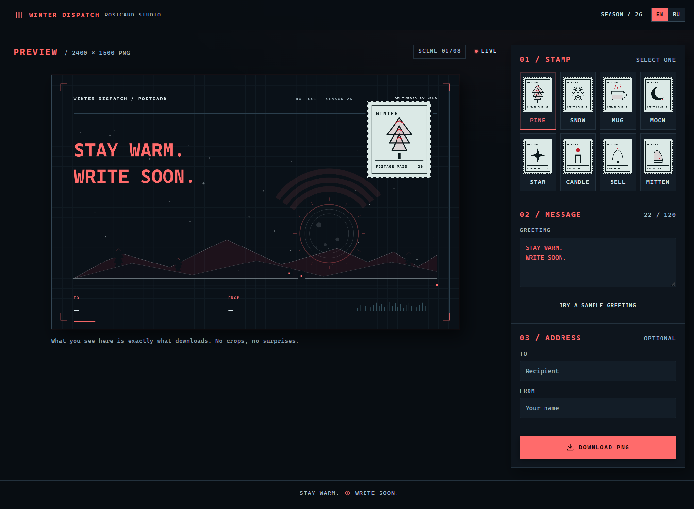
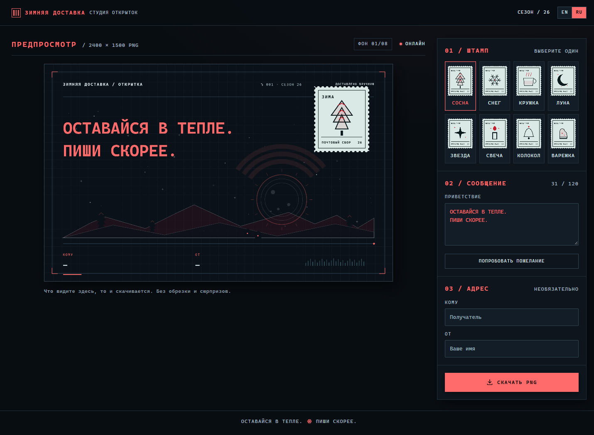

# holiday-postcard

A bilingual winter postcard studio: pick a stamp, write a greeting, address the card and download the exact image you see as a 2400×1500 PNG.

[](LICENSE)



---

## Quick start

```bash
python3 -m http.server 8765
```

Open `http://127.0.0.1:8765/index.html`. The project is static HTML, CSS and JavaScript with no build step and no dependencies. Opening `index.html` directly from disk also works.

## What it does

- **Eight stamps.** Pine, snow, mug, moon, star, candle, bell and mitten, each drawn as vector art on the card and in an enlarged chooser preview.
- **Live postcard canvas.** The greeting, recipient and sender are drawn straight onto the card; the downloaded PNG is the same canvas, so the export always matches the preview.
- **English and Russian.** The EN/RU switch translates the studio and the text printed on the card. The choice is saved in `localStorage` and restored after a reload.
- **Eight thematic backgrounds.** Observatory, snowstorm, city, forest, aurora, railway, celebration and lanterns rotate every seven seconds. Editing restarts the timer so the scene never changes mid-typing.
- **Accessible labels.** Every label pair clears 4.5:1 contrast; status messages stay screen-reader-only, and reduced-motion users still get scene changes without the fade.

## Screenshots

| English | Russian |
| :---: | :---: |
|  |  |

## Configuration

| Setting | Default | What it does |
| --- | --- | --- |
| `EN / RU` | `EN` | Switches interface and card text; persisted under `winter-dispatch-lang`. |
| Stamp | `PINE` | Selects one of eight printed stamp designs. |
| Greeting | `STAY WARM. WRITE SOON.` | Up to 120 characters; lines wrap on the card. |
| Recipient / sender | empty | Optional address fields; printed in ice-white on the card. |
| Background scene | `01/08` | Rotates every 7000 ms while idle. |
| Export | `2400 × 1500 PNG` | Created from the preview canvas with no re-render step. |

## How it works

```
form fields ──> drawCard() ──> <canvas> ──> canvas.toBlob() ──> PNG
                    ^
      stamp art, translated labels, one of eight themed scenes
```

`app.js` owns every drawing operation. `index.html` supplies standard form controls; `styles.css` supplies the dark red palette and responsive layout. There is no framework, no server-side state and no network request: the only stored value is the language preference.

## Development

```bash
node --check app.js                 # syntax
node tools/verify-contrast.mjs     # 17 label pairs, floor 4.5:1
python3 -m http.server 8765        # manual browser check
```

The house-style check runs in CI through the pinned `aa-blinov/golden-repo` action. To run it locally, clone that repository and point its checker at this directory.

## License

[MIT](LICENSE), © Alexander Blinov.
